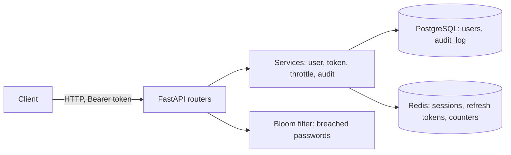
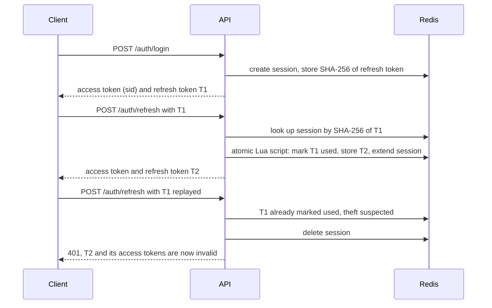

# auth-service

[](https://github.com/EvilTheron/auth-service/actions/workflows/ci.yml)

A standalone authentication and session-management service built with FastAPI, PostgreSQL and Redis. It issues short-lived JWT access tokens and rotating refresh tokens, detects refresh-token theft, manages per-device sessions, throttles credential-guessing attempts, rejects breached passwords using a custom Bloom filter, and records security events in an audit log.

## Features

- Registration and login with argon2id password hashing.
- Short-lived JWT access tokens (15 minutes) and opaque, rotating refresh tokens (30 days) with reuse detection.
- Session management: list devices, revoke a single session, log out everywhere. Revocation takes effect immediately.
- Brute-force protection: per-IP rate limiting and per-account lockout with exponential backoff.
- Breached-password screening at registration and password change, with a warning at login, backed by a custom Bloom filter.
- Role-based access control (`user`, `admin`), admin endpoints and an audit log.
- Request logging with request IDs; passwords, tokens and emails are never logged.
- Containerised with graceful shutdown; CI runs lint, strict type checks, migrations, tests and the image build.

## Tech stack

Python 3.14, FastAPI, SQLAlchemy 2.0 (async), PostgreSQL 17, Redis 7, Alembic, Pydantic, argon2-cffi, PyJWT, Docker Compose, pytest, Ruff, mypy, GitHub Actions, uv.

## Architecture



Routers handle only HTTP concerns (status codes, schemas); business logic lives in services. Dependencies (database session, Redis, current user, role checks) are wired through FastAPI's dependency injection, which also lets the test suite swap them for isolated test resources.

### Token lifecycle

An access token carries the session ID (`sid`). On every request the service verifies the signature and expiry and checks that the session still exists in Redis, so logout, session revocation and theft detection invalidate access tokens immediately instead of after they expire.

Refresh-token rotation runs as a single Lua script inside Redis. It checks that the session still exists, marks the old token as used and issues the new one in one atomic step, so a concurrent logout can never be undone by an in-flight refresh.



### Redis data model

| Key | Value |
|---|---|
| `session:{sid}` | Session record: user, user agent, IP, timestamps |
| `refresh:{sha256}` | Session ID. Only the hash of the refresh token is stored |
| `used:{sha256}` | Marker set on first use of a refresh token (theft detection) |
| `user_sessions:{user_id}` | Set of the user's session IDs |
| `login:fail:ip:*`, `login:fail:acct:*` | Failed-attempt counters |
| `login:lock:*`, `login:known:*` | Account lockouts and trusted (email, IP) pairs |
| `login:fail:known:*` | Failed attempts from a trusted pair |
| `register:ip:*` | Registration counters per IP |

All keys have a TTL, so expired data cleans itself up.

## API

| Endpoint | Description |
|---|---|
| `POST /auth/register` | Create an account |
| `POST /auth/login` | Authenticate (OAuth2 password form), returns an access and refresh token pair. `?delivery=cookie` puts the refresh token in an HttpOnly cookie instead of the body |
| `POST /auth/refresh` | Rotate the token pair. Reads the refresh token from the JSON body or, if absent, from the cookie, and returns the new one the same way |
| `POST /auth/logout` | End the current session and clear the refresh cookie |
| `POST /auth/logout-all` | End all sessions of the user and clear the refresh cookie |
| `POST /auth/change-password` | Change password and end all other sessions |
| `GET /users/me` | Current user |
| `GET /sessions` | List own sessions |
| `DELETE /sessions/{id}` | Revoke an own session |
| `GET /admin/users` | List users (admin) |
| `POST /admin/users/{id}/deactivate` | Deactivate a user and end their sessions (admin) |
| `GET /admin/audit` | Query the audit log with filters (admin) |
| `GET /health` | Liveness check: database and Redis connectivity |

Interactive documentation is served at `/docs` unless `DOCS_ENABLED=false`.

## Security model

| Threat | Mitigation |
|---|---|
| Database leak | Passwords stored as argon2id hashes; refresh tokens stored in Redis only as SHA-256 hashes |
| Password guessing | Per-IP limit (20 failures per 15 minutes); per-account lockout after 5 failures, 30 s doubling up to 1 hour; checked before password hashing so lockouts do not consume CPU. All thresholds are configurable |
| Registration abuse | At most 10 registrations per IP per hour; password hashing runs in a bounded thread pool so it cannot stall other requests |
| Weak or breached passwords | Bloom-filter screening at registration and password change; `password_compromised` flag at login |
| Refresh token theft | Rotation with reuse detection: replaying a used token terminates the whole session (after the optional grace period, off by default) |
| Access token theft | Short lifetime and a per-request session liveness check |
| Refresh token theft via XSS (browser clients) | Cookie delivery: `HttpOnly` (unreadable by scripts), `Secure`, `SameSite=Strict` (not sent cross-site, which also blocks CSRF), `Path=/auth`; the token is then never present in the response body |
| Race between refresh and logout | Rotation is one atomic Lua script, so a revoked session cannot be recreated |
| Token leakage via caches | Token responses carry `Cache-Control: no-store` |
| Account enumeration | Identical responses and equalised timing for unknown email and wrong password |
| Token forgery | Signature verification, explicit algorithm allow-list, required claims |
| Lockout abuse (denial of service) | An (email, IP) pair that logged in successfully in the last 30 days is trusted: neither the per-IP limit nor the account lockout applies to it, so an attacker cannot lock out the owner or, behind a shared IP (office NAT), everyone who has logged in before |
| Guessing from a trusted IP | A trusted pair loses its trust after 5 failed attempts and falls back to the per-IP limit and account lockout, so sharing an IP with the victim gives an attacker only a few extra tries |
| Privilege escalation | Role read from the database on every request, never from the token; admins can only be created by a server-side script; the database rejects unknown roles; foreign session IDs return 404 |
| Unauthorised Redis access | Redis requires a password and is reachable only from the Docker network and localhost |
| Weak signing key | The service refuses to start if `JWT_SECRET` is shorter than 32 characters |
| Secrets in logs | Passwords, tokens and emails are not logged; covered by a test |
| Audit log flooding | Blocked login attempts are not written to the audit log |

Audited events: `register`, `login_success`, `login_failed`, `refresh_reuse`, `logout`, `logout_all`, `session_revoked`, `password_changed`, `user_deactivated`, `role_changed`.

## Breached-password screening

The Bloom filter (`src/auth_service/bloom/filter.py`) is implemented from scratch: a bit array in a `bytearray`, positions derived with double hashing from a single `blake2b` digest, and size and hash count computed from the expected item count and target false-positive rate. A false positive means an occasional request to pick another password; there are no false negatives.

Benchmark (`scripts/bloom_benchmark.py`, 500,000 items, 1% target rate):

| | Bloom filter | Python `set` |
|---|---|---|
| Memory | 0.57 MiB (7 hashes) | 41.27 MiB |
| Measured false-positive rate | 0.98% | 0 |
| Lookup time | about 5 µs | |

A filter built from about one million common passwords at a 0.1% error rate takes roughly 1.7 MB (10 hashes).

## Design decisions and trade-offs

- **Session-bound access tokens.** Checking session liveness on every request gives immediate revocation at the cost of one Redis lookup per request. A pure stateless JWT would be cheaper but could not be revoked before expiry.
- **Two ways to deliver the refresh token.** Native and server-side clients get it in the response body, as in the OAuth 2.0 token endpoint; browser clients request `delivery=cookie` and get an HttpOnly cookie. A token is delivered one way only: also returning it in the body would let an injected script read it and defeat the cookie. The access token stays in the body in both modes and should be kept in memory; its 15-minute lifetime limits the damage of an XSS.
- **Reuse detection with an optional grace period.** By default any second use of a refresh token is treated as theft, so two concurrent refreshes (a double click, a retry on a flaky network) end the session. `REFRESH_REUSE_GRACE_SECONDS` lets a deployment accept a repeat within a few seconds of the first use as a client retry, as Auth0 and Okta do. The trade-off: inside that window a stolen token is not detected either, so the window is short and off by default. Returning the same new token on a retry would be cleaner but requires storing it, while Redis holds only hashes.
- **`409` on duplicate registration** reveals that an email is registered. Without email verification the alternative (answering success) would leave the owner unable to understand why they cannot log in. Mass probing is capped by the registration limit; email verification, which would answer every registration with "check your inbox", is the complete fix.
- **No Bloom filter for email lookups at login.** Considered and rejected: the saving over an indexed database lookup is negligible, and a desynchronised filter would wrongly reject real users.
- **Client IP behind a reverse proxy.** Throttling and known-IP checks depend on the real client address. Set `FORWARDED_ALLOW_IPS` to the proxy address; otherwise every client appears as the proxy, so a few failed logins block everyone and account lockouts stop applying.
- **Shared IP addresses.** Users behind one NAT share the per-IP counter. Only users who have not yet logged in from that address can be blocked by someone else's failures; a CAPTCHA after several failures would remove even that.
- **Migrations run at container start.** Convenient for a single instance; a multi-instance deployment should run them as a separate job.

## Getting started

Requirements: Docker and Git.

```bash
git clone https://github.com/EvilTheron/auth-service.git
cd auth-service
cp .env.example .env          # PowerShell: Copy-Item .env.example .env
```

Edit `.env`: set the database and Redis passwords and generate a signing key (at least 32 characters):

```bash
python -c "import secrets; print(secrets.token_urlsafe(48))"
```

Start everything:

```bash
docker compose up -d --build
```

The API is available at <http://127.0.0.1:8000/docs>. Migrations are applied on startup.

### Enable breached-password screening (optional)

Without a filter file the check is disabled.

1. Download a list of common passwords, for example from [SecLists](https://github.com/danielmiessler/SecLists/tree/master/Passwords/Common-Credentials), to `data/passwords.txt`.
2. Build the filter and restart the service:

```bash
uv run python scripts/build_leaked_filter.py data/passwords.txt data/leaked_passwords.bloom
docker compose restart app
```

### Create the first administrator

Roles cannot be changed through the API. Promote a registered user from the server:

```bash
docker compose exec app python scripts/make_admin.py user@example.com
```

## Configuration

Settings are read from environment variables (or `.env`).

| Variable | Default | Description |
|---|---|---|
| `POSTGRES_USER`, `POSTGRES_PASSWORD`, `POSTGRES_DB` | required | Database credentials |
| `POSTGRES_HOST`, `POSTGRES_PORT` | `127.0.0.1`, `5432` | Database address |
| `REDIS_HOST`, `REDIS_PORT` | `127.0.0.1`, `6379` | Redis address |
| `REDIS_PASSWORD` | none | Redis password (required by Docker Compose) |
| `JWT_SECRET` | required | Signing key, at least 32 characters |
| `JWT_ALGORITHM` | `HS256` | Signing algorithm |
| `ACCESS_TOKEN_EXPIRE_MINUTES` | `15` | Access token lifetime |
| `REFRESH_TOKEN_EXPIRE_DAYS` | `30` | Refresh token and session lifetime |
| `REFRESH_REUSE_GRACE_SECONDS` | `0` | Seconds after rotation during which the old refresh token is still accepted as a client retry; `0` treats every reuse as theft |
| `COOKIE_SECURE` | `true` | Mark the refresh cookie `Secure` (HTTPS only); set to `false` only for local development over plain HTTP |
| `LEAKED_PASSWORDS_FILTER_PATH` | `data/leaked_passwords.bloom` | Bloom filter file |
| `LOG_LEVEL` | `INFO` | Log level |
| `DOCS_ENABLED` | `true` | Serve `/docs` and `/openapi.json`; disable in production |
| `FORWARDED_ALLOW_IPS` | `127.0.0.1` | Reverse proxy addresses trusted to set `X-Forwarded-For` |
| `LOGIN_IP_MAX_FAILURES`, `LOGIN_IP_WINDOW_SECONDS` | `20`, `900` | Per-IP failed-login limit and window |
| `LOGIN_ACCOUNT_FREE_ATTEMPTS` | `5` | Failures before an account is locked |
| `LOGIN_LOCK_BASE_SECONDS`, `LOGIN_LOCK_MAX_SECONDS` | `30`, `3600` | First lockout duration (doubles each failure) and its cap |
| `LOGIN_KNOWN_IP_MAX_FAILURES` | `5` | Failures after which a trusted (email, IP) pair loses its trust |
| `REGISTRATION_LIMIT_PER_HOUR` | `10` | Registrations per IP per hour |

## Development

Run the application locally with databases in Docker:

```bash
docker compose up -d postgres redis
uv sync
uv run alembic upgrade head
uv run uvicorn auth_service.main:app --reload --no-access-log
```

## Testing and quality

The test suite (90+ tests, pytest and httpx) runs against a separate PostgreSQL database and Redis database 1, so development data is never touched. Create the test database once:

```bash
docker compose exec postgres psql -U auth -d auth_service -c "create database auth_service_test;"
uv run pytest --cov
```

Coverage is about 98% (CI enforces a minimum of 90%). The same checks run in GitHub Actions on every push, on a clean machine with PostgreSQL and Redis service containers:

```bash
uv run ruff check .
uv run ruff format --check .
uv run mypy            # strict mode
uv run pytest --cov
```

CI also applies all migrations to an empty database and builds the Docker image.

## Project layout

```text
src/auth_service/
├── api/          # routers and dependencies (token, role, DB session, Redis)
├── bloom/        # Bloom filter
├── core/         # settings, security primitives, Redis client, logging
├── db/           # models, session, declarative base
├── schemas/      # request and response schemas
└── services/     # business logic: users, tokens, throttling, audit
alembic/          # database migrations
scripts/          # filter builder, benchmark, admin promotion
tests/            # automated tests
```

## Limitations and roadmap

- No email verification and no second factor (TOTP).
- Sessions have no absolute lifetime: each refresh extends them.
- Deactivated users cannot be reactivated through the API.
- Every rotation leaves two small Redis keys (`refresh:` and `used:`) until the refresh TTL expires. At very large scale, tracking a per-session token generation would keep memory constant.
- Tokens are signed with a shared secret (HS256). Other services currently need the key and Redis access to validate tokens; a token introspection endpoint or asymmetric signing (RS256 with JWKS) is the natural next step.