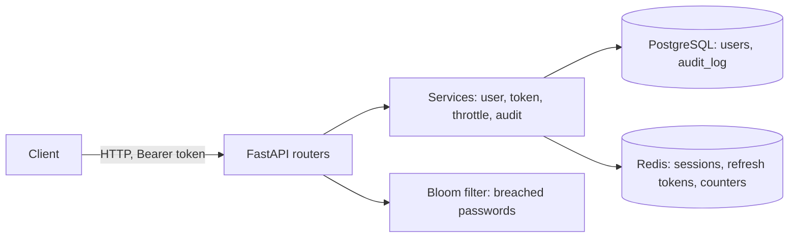
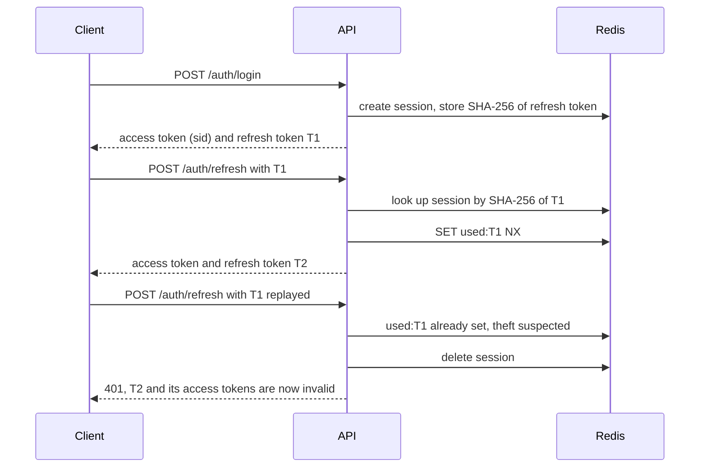

# auth-service

[](https://github.com/EvilTheron/auth-service/actions/workflows/ci.yml)

A standalone authentication and session-management service built with FastAPI, PostgreSQL and Redis. It issues short-lived JWT access tokens and rotating refresh tokens, detects refresh-token theft, manages per-device sessions, throttles credential-guessing attempts, rejects breached passwords using a custom Bloom filter, and records security events in an audit log.

## Features

- Registration and login with argon2id password hashing.
- Short-lived JWT access tokens (15 minutes) and opaque, rotating refresh tokens (30 days) with reuse detection.
- Session management: list devices, revoke a single session, log out everywhere. Revocation takes effect immediately.
- Brute-force protection: per-IP rate limiting and per-account lockout with exponential backoff.
- Breached-password screening at registration and password change, with a warning at login, backed by a custom Bloom filter.
- Role-based access control (`user`, `admin`), admin endpoints and an audit log.
- Request logging with request IDs; passwords, tokens and emails are never logged.
- Containerised, with CI running lint, strict type checks, migrations, tests and the image build.

## Tech stack

Python 3.14, FastAPI, SQLAlchemy 2.0 (async), PostgreSQL 17, Redis 7, Alembic, Pydantic, argon2-cffi, PyJWT, Docker Compose, pytest, Ruff, mypy, GitHub Actions, uv.

## Architecture



Routers handle only HTTP concerns (status codes, schemas); business logic lives in services. Dependencies (database session, Redis, current user, role checks) are wired through FastAPI's dependency injection, which also lets the test suite swap them for isolated test resources.

### Token lifecycle

An access token carries the session ID (`sid`). On every request the service verifies the signature and expiry and checks that the session still exists in Redis, so logout, session revocation and theft detection invalidate access tokens immediately instead of after they expire.



### Redis data model

| Key | Value |
|---|---|
| `session:{sid}` | Session record: user, user agent, IP, timestamps |
| `refresh:{sha256}` | Session ID. Only the hash of the refresh token is stored |
| `used:{sha256}` | Marker set on first use of a refresh token (theft detection) |
| `user_sessions:{user_id}` | Set of the user's session IDs |
| `login:fail:ip:*`, `login:fail:acct:*` | Failed-attempt counters |
| `login:lock:*`, `login:known:*` | Account lockouts and recently used IPs |

All keys have a TTL, so expired data cleans itself up.

## API

| Endpoint | Description |
|---|---|
| `POST /auth/register` | Create an account |
| `POST /auth/login` | Authenticate (OAuth2 password form), returns an access and refresh token pair |
| `POST /auth/refresh` | Rotate the token pair |
| `POST /auth/logout` | End the current session |
| `POST /auth/logout-all` | End all sessions of the user |
| `POST /auth/change-password` | Change password and end all other sessions |
| `GET /users/me` | Current user |
| `GET /sessions` | List own sessions |
| `DELETE /sessions/{id}` | Revoke an own session |
| `GET /admin/users` | List users (admin) |
| `POST /admin/users/{id}/deactivate` | Deactivate a user and end their sessions (admin) |
| `GET /admin/audit` | Query the audit log with filters (admin) |
| `GET /health` | Liveness and database connectivity |

Interactive documentation is served at `/docs`.

## Security model

| Threat | Mitigation |
|---|---|
| Database leak | Passwords stored as argon2id hashes; refresh tokens stored in Redis only as SHA-256 hashes |
| Password guessing | Per-IP limit (20 failures per 15 minutes); per-account lockout after 5 failures, 30 s doubling up to 1 hour; checked before password hashing so lockouts do not consume CPU |
| Weak or breached passwords | Bloom-filter screening at registration and password change; `password_compromised` flag at login |
| Refresh token theft | Rotation with reuse detection: replaying a used token terminates the whole session |
| Access token theft | Short lifetime and a per-request session liveness check |
| Account enumeration | Identical responses and equalised timing for unknown email and wrong password |
| Token forgery | Signature verification, explicit algorithm allow-list, required claims |
| Lockout abuse (denial of service) | Lockouts do not apply to IPs the owner has successfully logged in from in the last 30 days |
| Privilege escalation | Role read from the database on every request, never from the token; admins can only be created by a server-side script; foreign session IDs return 404 |
| Weak signing key | The service refuses to start if `JWT_SECRET` is shorter than 32 characters |
| Secrets in logs | Passwords, tokens and emails are not logged; covered by a test |
| Audit log flooding | Blocked login attempts are not written to the audit log |

Audited events: `register`, `login_success`, `login_failed`, `refresh_reuse`, `logout`, `logout_all`, `password_changed`, `user_deactivated`.

## Breached-password screening

The Bloom filter (`src/auth_service/bloom/filter.py`) is implemented from scratch: a bit array in a `bytearray`, positions derived with double hashing from a single `blake2b` digest, and size and hash count computed from the expected item count and target false-positive rate. A false positive means an occasional request to pick another password; there are no false negatives.

Benchmark (`scripts/bloom_benchmark.py`, 500,000 items, 1% target rate):

| | Bloom filter | Python `set` |
|---|---|---|
| Memory | 0.57 MiB (7 hashes) | 41.27 MiB |
| Measured false-positive rate | 0.98% | 0 |
| Lookup time | about 5 µs | |

A filter built from about one million common passwords at a 0.1% error rate takes roughly 1.7 MB (10 hashes).

## Design decisions and trade-offs

- **Session-bound access tokens.** Checking session liveness on every request gives immediate revocation at the cost of one Redis lookup per request. A pure stateless JWT would be cheaper but could not be revoked before expiry.
- **Refresh tokens are opaque and hashed.** They are returned in the response body for simplicity; a browser client should receive them in an HttpOnly cookie instead.
- **Strict reuse detection.** Two concurrent refresh requests with the same token are treated as theft. A short grace window would soften this for flaky clients.
- **`409` on duplicate registration** reveals that an email is registered. Email verification would remove the leak.
- **No Bloom filter for email lookups at login.** Considered and rejected: the saving over an indexed database lookup is negligible, and a desynchronised filter would wrongly reject real users.
- **Migrations run at container start.** Convenient for a single instance; a multi-instance deployment should run them as a separate job.

## Getting started

Requirements: Docker and Git.

```bash
git clone https://github.com/EvilTheron/auth-service.git
cd auth-service
cp .env.example .env          # PowerShell: Copy-Item .env.example .env
```

Edit `.env`: set a database password and generate a signing key (at least 32 characters):

```bash
python -c "import secrets; print(secrets.token_urlsafe(48))"
```

Start everything:

```bash
docker compose up -d --build
```

The API is available at <http://127.0.0.1:8000/docs>. Migrations are applied on startup.

### Enable breached-password screening (optional)

Without a filter file the check is disabled.

1. Download a list of common passwords, for example from [SecLists](https://github.com/danielmiessler/SecLists/tree/master/Passwords/Common-Credentials), to `data/passwords.txt`.
2. Build the filter and restart the service:

```bash
uv run python scripts/build_leaked_filter.py data/passwords.txt data/leaked_passwords.bloom
docker compose restart app
```

### Create the first administrator

Roles cannot be changed through the API. Promote a registered user from the server:

```bash
docker compose exec app python scripts/make_admin.py user@example.com
```

## Configuration

Settings are read from environment variables (or `.env`).

| Variable | Default | Description |
|---|---|---|
| `POSTGRES_USER`, `POSTGRES_PASSWORD`, `POSTGRES_DB` | required | Database credentials |
| `POSTGRES_HOST`, `POSTGRES_PORT` | `127.0.0.1`, `5432` | Database address |
| `REDIS_HOST`, `REDIS_PORT` | `127.0.0.1`, `6379` | Redis address |
| `JWT_SECRET` | required | Signing key, at least 32 characters |
| `JWT_ALGORITHM` | `HS256` | Signing algorithm |
| `ACCESS_TOKEN_EXPIRE_MINUTES` | `15` | Access token lifetime |
| `REFRESH_TOKEN_EXPIRE_DAYS` | `30` | Refresh token and session lifetime |
| `LEAKED_PASSWORDS_FILTER_PATH` | `data/leaked_passwords.bloom` | Bloom filter file |
| `LOG_LEVEL` | `INFO` | Log level |

## Development

Run the application locally with databases in Docker:

```bash
docker compose up -d postgres redis
uv sync
uv run alembic upgrade head
uv run uvicorn auth_service.main:app --reload --no-access-log
```

## Testing and quality

The test suite (60+ tests, pytest and httpx) runs against a separate PostgreSQL database and Redis database 1, so development data is never touched. Create the test database once:

```bash
docker compose exec postgres psql -U auth -d auth_service -c "create database auth_service_test;"
uv run pytest --cov
```

Coverage is about 98% (CI enforces a minimum of 90%). The same checks run in GitHub Actions on every push, on a clean machine with PostgreSQL and Redis service containers:

```bash
uv run ruff check .
uv run ruff format --check .
uv run mypy            # strict mode
uv run pytest --cov
```

CI also applies all migrations to an empty database and builds the Docker image.

## Project layout

```text
src/auth_service/
├── api/          # routers and dependencies (token, role, DB session, Redis)
├── bloom/        # Bloom filter
├── core/         # settings, security primitives, Redis client, logging
├── db/           # models, session, declarative base
├── schemas/      # request and response schemas
└── services/     # business logic: users, tokens, throttling, audit
alembic/          # database migrations
scripts/          # filter builder, benchmark, admin promotion
tests/            # automated tests
```

## Limitations and roadmap

- No email verification and no second factor (TOTP).
- Registration is not rate limited.
- Behind a reverse proxy, configure trusted forwarding headers (`--proxy-headers`, `--forwarded-allow-ips` in uvicorn); otherwise all clients appear to share one IP.
- Sessions have no absolute lifetime: each refresh extends them.
- Tokens are signed with a shared secret (HS256). Other services currently need the key and Redis access to validate tokens; a token introspection endpoint or asymmetric signing (RS256 with JWKS) is the natural next step.